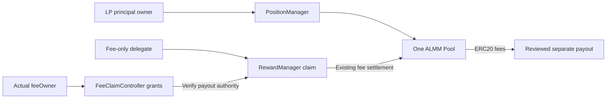

# Stablecoin partners: start with one ALMM model

New integrators should follow the [partner quickstart](https://docs.ammora.org/guides/stablecoin-quickstart) from wallet, funding and token policy registration through pools, trading and fee claims. The [validation scope](https://github.com/AmmoraLabs/ammora-examples/blob/main/VALIDATION.md) is also available.

This guide uses the **explicit opt-in deployment `giwa-almm-unified-v1`** on GIWA Sepolia (91342). It connects 1 bp trading, LP deposits, fee-only delegation, claims to a separate payout, full LP withdrawal, empty-NFT closure and re-entry in the same pool. Existing canonical deployments and LP positions are not migrated automatically.

Install public SDK **0.3.9**. Fee readiness, delegation, revocation and separate-payout claim planners are official `@ammora-protocol/sdk` exports. The retained [import path](https://docs.ammora.org/examples/source/extensions/almm-unified/fee-claims-compat.ts.txt) only re-exports those functions and types; install the public npm package and retain the reviewed GIWA profile.

## Approval and review boundaries

For this explicitly selected GIWA profile, a partner can use an already supported pair and ready preset without per-partner Ammora approval. It supplies its own liquidity and gas; the actual feeOwner grants/revokes fee-only delegation and the caller/payout must match that grant. NFT ownership or approval alone does not establish fee-routing authority.

Unclassified standard tokens may use this profile's supported policy probe. Owner-restricted policies, new presets/implementations and production/issuer deployment acceptance need separate review. Do not transfer this profile's permissions to another catalog or fee-routing revision. See [partner permissions](PERMISSIONS.md).

## Use the official fee SDK

```ts
import {
  getALMMFeeClaimReadiness,
  planSetALMMFeeClaimDelegate,
  planRevokeALMMFeeClaimDelegate,
  planClaimALMMPositionFeesTo,
} from "@ammora-protocol/sdk";
```

The CLI builds these calls with `selectedProfile().feeOptions`, which explicitly selects fee-routing revision1 and pins the GIWA contracts. A fixed payout is the default. Only a reviewed fee owner may grant or revoke a delegate; NFT approval alone does not grant fee-routing authority. Readiness and plans do not send a transaction or prove payment. Existing deployments retain their own revision and behavior.


## Preparation

```bash
npm ci
export AMMORA_CHAIN_ID=91342
export AMMORA_GIWA_GENERATION=auto-route
export AMMORA_RPC_URL=https://sepolia-rpc.giwa.io
export AMMORA_READ_RECEIPT=''
export AMMORA_ACCOUNT=0xYOUR_CALLER
```

Separate wallets and funding as follows.

| Role | Requirements | Authority |
| --- | --- | --- |
| LP owner | Both ERC20 assets and GIWA gas ETH | Deposit/withdraw LP and manage the NFT; also owns fees for ordinary LP positions |
| Separate fee owner (optional) | Reviewed EOA or smart account | Actual bootstrap `positionFeeOwner`; manages only its own fee grants and revocations |
| Fee-only delegate | GIWA gas ETH | Claims the specified fees; no principal, NFT or reward authority |
| Separate payout | Address able to receive ERC20 assets | Receives funds and need not sign |
| Issuer | Official GIWA asset addresses, decimals, and review of code, upgrades, minting, pause and blacklist controls | Owns issuance, redemption and bridging responsibilities |

Both assets must be reviewed exact-transfer ERC20s. If official GIWA FDUSD/cUSD addresses or approvals are unresolved, **issuer onboarding remains incomplete**. Synthetic test success does not establish official issuer support, dollar redemption or a peg guarantee. Complete the asset, authority, funding and risk review in the [existing issuer integration guide](https://docs.ammora.org/guides/stablecoin-partner) first.

Use the existing manifest format with `model: "almm"` and omit the old synthetic-only `deployment` field. This example module selects the new shared profile. Specify `roles.liquidityOwner`, `roles.feeDelegate` and `roles.payout`. Add the ALMM extension's optional `roles.feeOwner` only to separate fee ownership from LP ownership. Confirm `origin` and asset reviews as `reviewed`. Existing manifests remain usable.

Different partners, recipients and assets do not require redeploying the shared contracts. The [shared deployment and runtime pins](https://docs.ammora.org/examples/source/extensions/almm-unified/giwa-profile.json.txt) are neither asset allowlists nor issuer approvals.

Prices are **human-readable quote/base prices**; distinguish decimals and raw units. A human 1:1 price for an 18/6-decimal pair is not raw 1:1. Record independent price evidence, observation time, maximum deviation, trading loss, slippage, funding, gas and TTL in the manifest. A pool cannot certify its own peg. New exposure rejects stale evidence.

## Plan → review → execute

All commands default to unsigned plans. Write **raw amounts as strings** in request JSON, and include a fresh explicit `deadline` for state changes. It must be later than the current block timestamp and within the manifest's `planTtlSeconds`.

```bash
npx --no-install tsx extensions/almm-unified/plan.ts OPERATION manifest.json request.json plan.json
```

Review caller, target, calldata, amounts, recipients, approvals and `reviewHash` in `plan.json`. Only when sending, use the existing secure signer loader to inject the key into process memory. Never put keys in the repository, output or client environment files.

```bash
export AMMORA_SEND=1
export AMMORA_UNIFIED_REVIEW_HASH=REVIEWED_PLAN_HASH
npx --no-install tsx extensions/almm-unified/execute.ts plan.json
```

The executor replans against current state and verifies **identical calldata**, then checks nonce, simulation and gas budget. It signs one transaction at a time, saves the signed hash in `.validation/almm-unified/<caller>-<nonce>.json` before broadcasting, and never retries broadcasts. A successful/unknown hash or existing nonce journal requires reconciliation of hash, nonce, receipt and canonical block first. Do not simply create another plan and resend.

Insufficient allowance stops execution. Review and execute each **exact approval** separately (`register-approve` for registration), then replan the main operation. The controller needs no ERC20 or NFT approval. For tokens requiring allowance reset, review an approval of zero before approving the new amount. Revoke remaining allowances to zero at the end.

New liquidity, trades and positive pool/Manager approvals recheck fresh price evidence. Registration probes and their exact Registry approvals are reviewed small round trips without new pool-price exposure, so they do not require price freshness. `approve(0)`, delegation revocation and principal withdrawal are not new price exposure and are not blocked solely by stale prices. Asset code, issuer controls, authority and pool-binding checks still apply.

## Operations and request fields

| Step / OPERATION | request.json fields | Expected result |
| --- | --- | --- |
| 0a. `policy` | `{}` | Read selected Factory/Registry bindings and both asset policies; no send |
| 0b. `register-approve` | `token`, `amount` | Exact Registry allowance for a reviewed pair token; zero can revoke it after registration |
| 0c. `register` | `token`, `amount` | Exact-transfer round-trip registration of an unclassified asset without an owner policy, with receipt/balance proof |
| 1. `discover` | `binStepBps` | Verify existing pool key, actual pair and fee; review/reuse an existing pool instead of resending creation |
| 2. `create` | `binStepBps` | Calculate initial bin from manifest price/decimals; empty-pool creation is separate from asset issuance |
| 3. `approve` | `pool`, `token`, `spender`, `amount` | Token must be a reviewed pair asset; spender must be that pool or shared Position Manager; amount stays within budget |
| 4. `seed` | `pool`, `maximumBaseRaw`, `maximumQuoteRaw`, `lowerBinId`, `upperBinId`, `slippageBps`, `deadline` | Actual Position NFT tokenId and shares; example supports up to 64 bins |
| 5. `swap` | `pool`, `includedAmountIn`, `baseForQuote`, `slippageBps`, `deadline` | Both trade directions, including fees/slippage and actual ERC20 receipts |
| 6. `inspect` | `pool`, `tokenId` | Ownership, grant mode/expiry/epoch, claim authority and positive-fee preview |
| 7. `grant` | `pool`, `tokenId`, `delegate`, optional `recipientMode`, `expiresAt` | Actual feeOwner only; default `fixed`, with payout choice added only by explicit `any` |
| 8. `claim` | `pool`, `tokenId`, optional `binIds` | Execute as the delegate; reconcile actual transfers and recipient balance increases |
| 9. `revoke` | `pool`, `tokenId`, `delegate` or `revokeAll:true` | Confirm claims fail after individual/all-grant revocation |
| 10. `exit` | `pool`, `tokenId`, `slippageBps`, `deadline` | Withdraw all actual bin shares with a withdrawal-only rebalance; principal returns to the LP owner |
| 11. `claim`, `close` | `pool`, `tokenId` | Claim remaining positive fees first; zero fees are not successful payment; close the empty NFT |
| 12. `approve`, `seed` | Same as above | Re-enter the same pool with a new NFT; old grants do not apply to it |

`recipient` must match reviewed `roles.payout`. A default fixed grant pays **only that address**. `recipientMode:"any"` is broader payout authority separately granted by the actual feeOwner; review the next payout in the manifest too. Neither mode grants principal withdrawal, NFT transfer, reward claims or governance authority. `expiresAt:"0"` deliberately means no expiry; transfer and revocation still apply.

NFT transfers invalidate old grants even on an A → B → A round trip. If a bootstrap position's feeOwner differs from the NFT owner, that fee owner's rights are preserved. Existing permissionless claims pay only the existing feeOwner and cannot redirect funds. For more than 64 fee bins, submit sorted `binIds` in batches of at most 64 with a fresh preview for each.

Smart accounts wrap the plan's `to/data/value` in their reviewed executor. Do not put another wallet's key into the EOA executor. GIWA validation kept one approved signing key while using a smart account with a distinct actual `msg.sender` as the delegate.

Claim execution uses the [verification function](https://docs.ammora.org/examples/source/extensions/almm-unified/proof.ts.txt) to reconcile the exact RewardManager's `ALMMPositionFeeClaimed` event, caller/NFT/pool/recipient, both ERC20 transfers and balances before/at the receipt block. A zero-fee no-op without a balance increase is a failed payment check. Authority rejection is checked by `eth_call`, without deliberately broadcasting failing transactions.

## Separate fee owners and authority rejections

If `roles.feeOwner` differs from the LP owner, `seed` uses public SDK 0.3.9's `createBootstrapPosition` ABI. It uses the same strategy quote and minimum shares; the provider is NFT recipient/operator and `lockReleasePoint=0`. **This example does not add a time lock.** The bootstrap ABI enforces `deadline` and per-bin `minimumShares`; it has no strategy-creation active-bin pin parameter. Price, code and roles are rechecked immediately before execution, so changed state also requires a fresh bootstrap review. Omitting feeOwner or setting it equal to the LP owner uses ordinary seed. Existing NFT/fee ownership is unchanged.

For an existing bootstrap NFT, read `positionFeeOwner(tokenId)` first and set manifest `feeOwner` accordingly. A mismatch stops fee operations before signing. A grant's `delegate` must also match reviewed `roles.feeDelegate`. The actual feeOwner can revoke historical grants even if the currently selected delegate has changed.

| Caller / request | Expected result | Partner action |
| --- | --- | --- |
| Actual feeOwner grants/revokes | Allowed | Select actual feeOwner as `AMMORA_ACCOUNT`; smart accounts use their reviewed executor |
| Valid fixed delegate → fixed payout | Allowed | Match manifest recipient and on-chain grant |
| NFT owner redirects a separate feeOwner's fees | `Unauthorized()` | Actual feeOwner must approve the executor and payout |
| Issuer admin or payout address alone claims LP fees | Rejected | Issuance authority or being a recipient does not confer LP claim authority |
| Fixed delegate → another payout | `Unauthorized()` | feeOwner reviews a new fixed grant or explicit any-recipient authority |
| Claim after revocation, expiry or NFT transfer | Rejected | Check ownership/epoch and create only the needed new grant |
| Fee-only wallet withdraws principal/transfers NFT | Rejected | LP owner separately approves principal/NFT operations |

These rejections protect normal onboarding with the correct caller and payout. `poolAllowed=false`, issuer pause/blacklist, a wrong deployment, or insufficient allowance/gas/funds **can block the legitimate path**. Review official addresses, code, controls, required Registry approvals, transfer destinations and funding first. Do not bypass checks or automatically grant LP authority to issuer admins.

New standard ERC20s may use the selected Registry's `registerStandardToken` exact round-trip verification path. Review probe amount, allowance and issuer transfer restrictions first. This path cannot reclassify assets with an owner-defined policy. Changing an owner-set `poolAllowed=false` requires separate Registry-owner review. Registering the issuer as a launch registrar is not mandatory for every stablecoin integration. Aggregation-router approval is separate from direct pool trading.

Do not send concurrent transactions from one EOA. If the nonce differs from expectations, stop before signing and reconcile other transaction hashes, nonces, receipts, canonical blocks and relevant asset state. Never resend a successful transaction.

The [validation scope](https://github.com/AmmoraLabs/ammora-examples/blob/main/VALIDATION.md) covers new ordinary/separate-feeOwner positions, actual separate payouts and authority rejection rechecks.

## Deployment structure and choosing a model

Shared Factory, PositionManager, RewardManager, FeeClaimController and related modules are configured **once per chain and qualified revision**. Tokens, pools, LP positions and recipients are added as data. The controller holds no assets and reuses existing fee settlement. Grant reads, writes and revoke-all are O(1); claims scale with at most 64 bins, without iterating over all users.

| Requirement | Recommended choice |
| --- | --- |
| Low fees, fee-only delegation, separate payouts, full last-LP exit and re-entry | This new ALMM profile |
| Existing operational ALMM / ARL pools | Keep their existing guides/deployments; no automatic migration or upgrade |
| TWAP-based MarketSync automation | Define and verify separate price, operator, cooldown and range policies; not automatically enabled here |
| New issuer-native GIWA assets | Review official addresses, authority, policy, funding and price evidence, then start a new pair on the shared profile |


See the [validation scope](https://github.com/AmmoraLabs/ammora-examples/blob/main/VALIDATION.md) for actual hashes, amounts, withdrawals, original failures and classifications. It does not establish completion of new MarketSync policy, official issuer assets or mainnet/production support.

## Developer validation commands

The extension supplies its own package typecheck/tests; existing public SDK examples remain covered by the root audit.

```bash
npm --prefix extensions/almm-unified run typecheck
npm --prefix extensions/almm-unified test
```



The profile's start blocks and runtime pins are fixed per ALMM role. Test delegate accounts appear only in validation evidence and are not required dependencies for partners. Use the extension options for ALMM calls; Launch and other existing features retain their own deployment selection.
